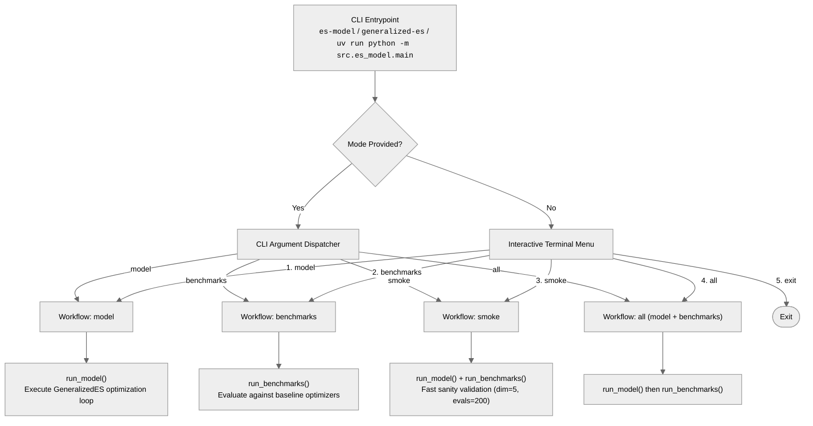
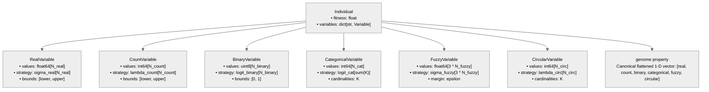
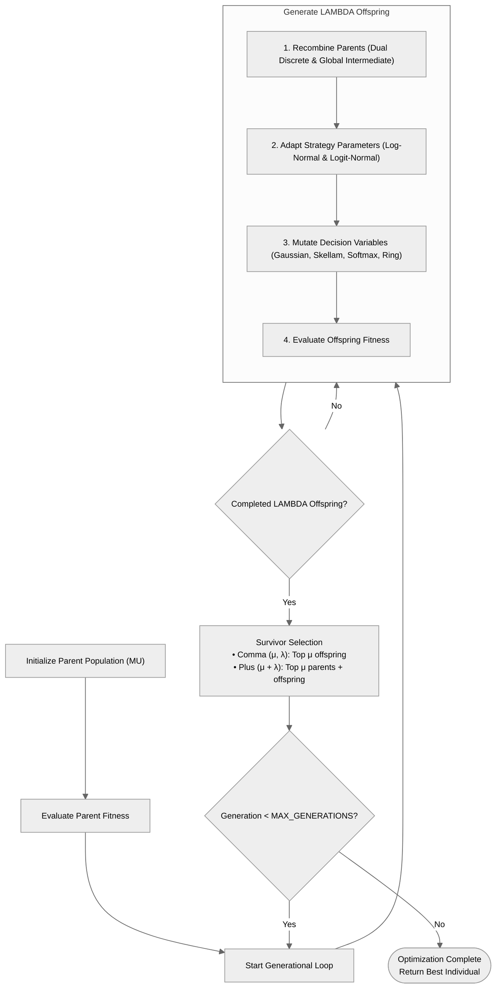
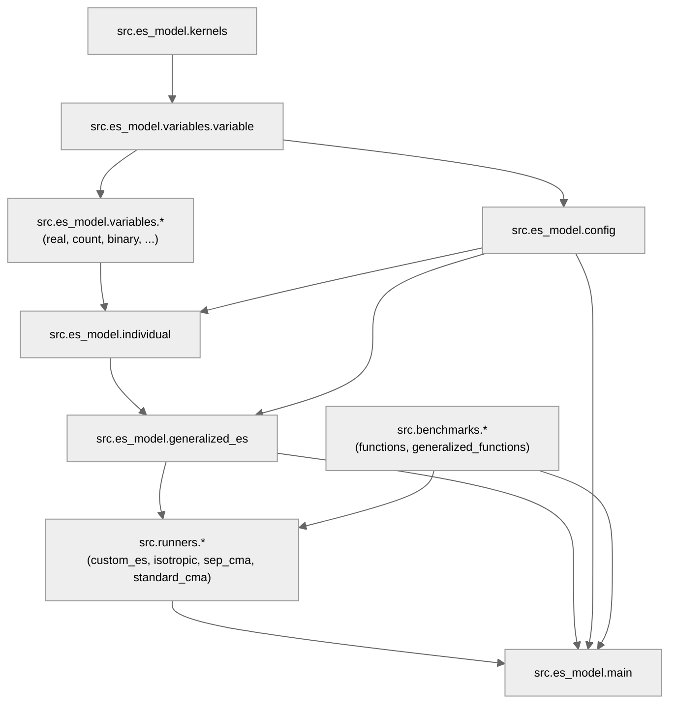

# Generalized Evolution Strategies for Mixed-Variable Optimization

An experimental TFG from a student at the FIB UPC, specializing in Computer Science.

This framework implements **Generalized Evolution Strategies (ES)** supporting mixed-variable optimization under $(\mu, \lambda)$ and $(\mu + \lambda)$ selection schemes with log-normal and logit-normal self-adaptation. It features modular variable representations across 6 distinct types, benchmark suites, and comparative runners against standard baseline optimizers (*Isotropic ES*, *sep-CMA-ES*, and *Standard CMA-ES*). The project is fully managed and executed via [uv](https://docs.astral.sh/uv/).

---

## Architecture & Technical Overview

### 1. Mixed-Variable Genome & Mutation Kernels

The system co-evolves 6 decision variable types alongside their respective strategy parameters within a unified [`Individual`](file:///c:/Users/bejmo/Documents/documents/GitHub/TFG/src/es_model/individual.py) genome:

| Variable Type | Domain | Strategy Parameter | Mutation Operator | Mathematical Kernel / Dynamics |
| :--- | :--- | :--- | :--- | :--- |
| **Real ($\mathbb{R}$)** | $\mathbb{R}^{N_{\text{real}}}$ | $\sigma_{\text{real}} \in \mathbb{R}_{>0}^{N_{\text{real}}}$ | Gaussian | $x' = \text{reflect}(x + \sigma \cdot \mathcal{N}(0,1), [L, U])$ |
| **Count ($\mathbb{Z}$)** | $\mathbb{Z}_{\ge 0}^{N_{\text{count}}}$ | $\lambda_{\text{count}} \in \mathbb{R}_{>0}^{N_{\text{count}}}$ | Skellam | $x' = \text{clip}(x + \text{Poisson}(\lambda) - \text{Poisson}(\lambda), [L, U])$ |
| **Binary ($\mathbb{B}$)** | $\mathbb{B}^{N_{\text{binary}}}$ | $\text{logit}_{\text{binary}} \in \mathbb{R}^{N_{\text{binary}}}$ | Bit-Flip | XOR guided by Bernoulli($p$), where $p = \sigma(\text{logit})$ |
| **Categorical ($\mathbb{C}$)** | $\mathbb{C}^{N_{\text{cat}}}$ | $\text{logit}_{\text{cat}} \in \mathbb{R}^{\sum C_k}$ | Softmax Resample | Sample from categorical distribution $p = \text{softmax}(\text{logits})$ |
| **Fuzzy ($\mathbb{F}$)** | $\mathbb{F}^{3 \cdot N_{\text{fuzzy}}}$ | $\sigma_{\text{fuzzy}} \in \mathbb{R}_{>0}^{3 \cdot N_{\text{fuzzy}}}$ | Gaussian + Mirror | Perturb triplets $(a, b, c)$, reflect on $[0, 1]$, enforce $a \le b \le c$ ($\epsilon=10^{-4}$) |
| **Circular ($\mathbb{O}$)** | $\mathbb{O}^{N_{\text{circ}}}$ | $\lambda_{\text{circ}} \in \mathbb{R}_{>0}^{N_{\text{circ}}}$ | Modular Skellam | $x' = (x + \text{Poisson}(\lambda) - \text{Poisson}(\lambda)) \pmod k$ |

### 2. Self-Adaptation Rules

- **Global & Local Learning Rates:**
  $$\tau' = \frac{1}{\sqrt{2 \cdot N_{\text{total}}}}, \quad \tau = \frac{1}{\sqrt{2 \cdot \sqrt{N_{\text{total}}}}}$$
  where $N_{\text{total}} = N_{\text{real}} + N_{\text{count}} + N_{\text{binary}} + N_{\text{cat}} + 3 \cdot N_{\text{fuzzy}} + N_{\text{circ}}$.

- **Log-Normal Adaptation** (for scale parameters $\sigma_{\text{real}}, \lambda_{\text{count}}, \sigma_{\text{fuzzy}}, \lambda_{\text{circ}}$):
  $$\sigma_i' = \max\left(\sigma_{\text{floor}}, \, \sigma_i \cdot \exp\left(\tau' \cdot \mathcal{N}(0,1) + \tau \cdot \mathcal{N}_i(0,1)\right)\right), \quad \sigma_{\text{floor}} = 10^{-6}$$

- **Logit-Normal Adaptation** (for probability parameters $\text{logit}_{\text{binary}}, \text{logit}_{\text{cat}}$):
  $$\text{logit}_i' = \text{logit}_i + \tau \cdot \mathcal{N}_i(0,1)$$

---

## Diagrams & Control Flow

### System Execution Flow



### Genome & Candidate Representation



### Algorithmic Lifecycle Loop



---

## Project Structure & Module Dependency Matrix

```text
TFG/
├── README.md                                                                                   # Main project documentation
├── pyproject.toml                                                                              # Project metadata, dependencies & CLI scripts (PEP 621)
├── uv.lock                                                                                     # Deterministic cross-platform lockfile
├── .python-version                                                                             # Pinned Python version (3.12)
├── src/                                                                                        # Core source code
│   ├── es_model/                                                                               #   Generalized ES Engine
│   │   ├── config.py                                                                           #     Problem settings, bounds, dimensions & learning rates
│   │   ├── kernels.py                                                                          #     Pure math functions for activation & self-adaptation
│   │   ├── individual.py                                                                       #     Candidate solution representation & genetic operators
│   │   ├── generalized_es.py                                                                   #     GeneralizedES optimizer class & survivor selection
│   │   ├── main.py                                                                             #     CLI entrypoint, interactive menu & execution workflows
│   │   └── variables/                                                                          #     Modular variable representations & mutation operators
│   │       ├── variable.py                                                                     #       Variable ABC & resolve_bounds utility
│   │       ├── real.py                                                                         #       RealVariable (Gaussian mutation with reflection)
│   │       ├── count.py                                                                        #       CountVariable (Skellam mutation with clipping)
│   │       ├── binary.py                                                                       #       BinaryVariable (Bit-flip mutation via sigmoid)
│   │       ├── categorical.py                                                                  #       CategoricalVariable (Softmax resample)
│   │       ├── fuzzy.py                                                                        #       FuzzyVariable (Gaussian mirror with order preservation)
│   │       └── circular.py                                                                     #       CircularVariable (Modular Skellam ring mutation)
│   ├── benchmarks/                                                                             #   Objective Benchmark Landscapes
│   │   ├── functions.py                                                                        #     Standard continuous landscapes (Sphere, Rastrigin, Ackley)
│   │   └── generalized_functions.py                                                            #     Synthetic mixed-variable landscapes testing all 6 types
│   └── runners/                                                                                #   Experimental Benchmark Runners
│       ├── custom_es.py                                                                        #     Generalized ES runner adapter
│       ├── isotropic_es.py                                                                     #     Isotropic ES baseline (single scalar step-size)
│       ├── sep_cma_es.py                                                                       #     Separable CMA-ES baseline wrapper
│       └── standard_cma_es.py                                                                  #     Standard CMA-ES upper-bound runner
├── tests/                                                                                      # Unit & integration test suites
│   ├── test_variables.py                                                                       #     Variable representations & mutation tests
│   ├── test_individual_and_es.py                                                               #     Candidate individual & ES optimization cycle tests
│   └── test_benchmarks.py                                                                      #     Continuous & generalized benchmark landscape tests
└── experiments/                                                                                # Experimental Notebooks
    ├── experiment_1.ipynb                                                                      #     Equal-budget benchmark comparisons and plots
    └── experiment_2.ipynb                                                                      #     Synthetic mixed-variable optimization across all 6 variable types
```

### Module Dependency Graph



### Module Dependency Matrix

| Module | Primary Responsibility | Key Symbols / Classes | Internal Dependencies | Imported By |
| :--- | :--- | :--- | :--- | :--- |
| [`src.es_model.config`](file:///c:/Users/bejmo/Documents/documents/GitHub/TFG/src/es_model/config.py) | Configuration dataclass, hyper-parameters, bounds & learning rates | [`ESConfig`](file:///c:/Users/bejmo/Documents/documents/GitHub/TFG/src/es_model/config.py#L10), `DEFAULT_CONFIG` | [`variables.variable`](file:///c:/Users/bejmo/Documents/documents/GitHub/TFG/src/es_model/variables/variable.py) | `individual`, `generalized_es`, `main`, `runners`, `tests` |
| [`src.es_model.kernels`](file:///c:/Users/bejmo/Documents/documents/GitHub/TFG/src/es_model/kernels.py) | Stateless numerical primitives, log-normal/logit adaptation, activation | `apply_lognormal_selfadaptation`, `adapt_logits`, `sigmoid`, `softmax` | None | [`variables.variable`](file:///c:/Users/bejmo/Documents/documents/GitHub/TFG/src/es_model/variables/variable.py), variable blocks |
| [`src.es_model.variables.variable`](file:///c:/Users/bejmo/Documents/documents/GitHub/TFG/src/es_model/variables/variable.py) | Abstract base class for variable types and universal bounds resolver | [`Variable`](file:///c:/Users/bejmo/Documents/documents/GitHub/TFG/src/es_model/variables/variable.py#L70), `resolve_bounds` | [`kernels`](file:///c:/Users/bejmo/Documents/documents/GitHub/TFG/src/es_model/kernels.py) | [`config`](file:///c:/Users/bejmo/Documents/documents/GitHub/TFG/src/es_model/config.py), all variable modules |
| [`src.es_model.variables.*`](file:///c:/Users/bejmo/Documents/documents/GitHub/TFG/src/es_model/variables) | Concrete variable implementations with type-specific mutations | `RealVariable`, `CountVariable`, `BinaryVariable`, `CategoricalVariable`, `FuzzyVariable`, `CircularVariable` | [`variable.Variable`](file:///c:/Users/bejmo/Documents/documents/GitHub/TFG/src/es_model/variables/variable.py), [`kernels`](file:///c:/Users/bejmo/Documents/documents/GitHub/TFG/src/es_model/kernels.py) | [`individual`](file:///c:/Users/bejmo/Documents/documents/GitHub/TFG/src/es_model/individual.py), `tests` |
| [`src.es_model.individual`](file:///c:/Users/bejmo/Documents/documents/GitHub/TFG/src/es_model/individual.py) | Candidate solution representation, discrete recombination & genome extraction | [`Individual`](file:///c:/Users/bejmo/Documents/documents/GitHub/TFG/src/es_model/individual.py#L28), [`UnpackedGenome`](file:///c:/Users/bejmo/Documents/documents/GitHub/TFG/src/es_model/individual.py#L222), `unpack_genome` | [`config`](file:///c:/Users/bejmo/Documents/documents/GitHub/TFG/src/es_model/config.py), [`variables`](file:///c:/Users/bejmo/Documents/documents/GitHub/TFG/src/es_model/variables) | [`generalized_es`](file:///c:/Users/bejmo/Documents/documents/GitHub/TFG/src/es_model/generalized_es.py), `main`, `benchmarks`, `tests` |
| [`src.es_model.generalized_es`](file:///c:/Users/bejmo/Documents/documents/GitHub/TFG/src/es_model/generalized_es.py) | Stateful optimization engine and $(\mu, \lambda) / (\mu + \lambda)$ survivor selection | [`GeneralizedES`](file:///c:/Users/bejmo/Documents/documents/GitHub/TFG/src/es_model/generalized_es.py#L41), `select_survivors` | [`config`](file:///c:/Users/bejmo/Documents/documents/GitHub/TFG/src/es_model/config.py), [`individual`](file:///c:/Users/bejmo/Documents/documents/GitHub/TFG/src/es_model/individual.py) | [`main`](file:///c:/Users/bejmo/Documents/documents/GitHub/TFG/src/es_model/main.py), [`runners.custom_es`](file:///c:/Users/bejmo/Documents/documents/GitHub/TFG/src/runners/custom_es.py), `tests` |
| [`src.benchmarks.functions`](file:///c:/Users/bejmo/Documents/documents/GitHub/TFG/src/benchmarks/functions.py) | Standard continuous optimization landscapes | `BENCHMARKS` (`Sphere`, `Rastrigin`, `Rosenbrock`, `Ackley`) | None | [`main`](file:///c:/Users/bejmo/Documents/documents/GitHub/TFG/src/es_model/main.py), `runners`, `tests` |
| [`src.benchmarks.generalized_functions`](file:///c:/Users/bejmo/Documents/documents/GitHub/TFG/src/benchmarks/generalized_functions.py) | Synthetic mixed-variable test landscapes across all 6 domain types | `sphere_generalized`, `rastrigin_generalized`, `coupled_generalized` | [`config`](file:///c:/Users/bejmo/Documents/documents/GitHub/TFG/src/es_model/config.py), [`individual`](file:///c:/Users/bejmo/Documents/documents/GitHub/TFG/src/es_model/individual.py) | `experiments`, `tests` |
| [`src.runners.*`](file:///c:/Users/bejmo/Documents/documents/GitHub/TFG/src/runners) | Optimizer execution adapters and baseline wrappers | `custom_es.run`, `isotropic_es.run`, `sep_cma_es.run`, `standard_cma_es.run` | [`generalized_es`](file:///c:/Users/bejmo/Documents/documents/GitHub/TFG/src/es_model/generalized_es.py), [`config`](file:///c:/Users/bejmo/Documents/documents/GitHub/TFG/src/es_model/config.py) | [`main`](file:///c:/Users/bejmo/Documents/documents/GitHub/TFG/src/es_model/main.py) |
| [`src.es_model.main`](file:///c:/Users/bejmo/Documents/documents/GitHub/TFG/src/es_model/main.py) | Unified CLI parser, interactive menu & workflow orchestrator | `main`, `run_model`, `run_benchmarks` | [`config`](file:///c:/Users/bejmo/Documents/documents/GitHub/TFG/src/es_model/config.py), [`generalized_es`](file:///c:/Users/bejmo/Documents/documents/GitHub/TFG/src/es_model/generalized_es.py), `benchmarks`, `runners` | CLI entrypoints (`es-model`, `generalized-es`) |

---

## Quick Setup with `uv`

This project is managed with [uv](https://docs.astral.sh/uv/), a fast Python package and project manager. `uv` handles Python installation, reproducible lockfiles, virtual environments, and package execution.

### 1. Install `uv` (if not already installed)

- **Windows (PowerShell):**
  ```powershell
  irm https://astral.sh/uv/install.ps1 | iex
  ```
- **Linux / macOS:**
  ```bash
  curl -LsSf https://astral.sh/uv/install.sh | sh
  ```

### 2. Synchronize Environment

From the project root directory, run:

```bash
uv sync
```

This single command automatically:
1. Downloads and pins **Python 3.12** (via `.python-version`).
2. Creates the virtual environment in `.venv`.
3. Resolves and installs all core dependencies (`numpy`, `matplotlib`, `cma`, `pymoo`).
4. Installs development dependencies (`pytest`, `ipykernel`).
5. Installs the project in editable mode with dedicated console shortcuts (`es-model`, `generalized-es`).

### 3. Optional: Activating the Virtual Environment

Commands can be run directly using `uv run ...` without manual activation. If you prefer activating the virtual environment in your terminal:

- **Windows (PowerShell):**
  ```powershell
  .venv\Scripts\activate
  ```
- **Linux / macOS:**
  ```bash
  source .venv/bin/activate
  ```

---

## Running the Project

Run all commands from the **project root** directory. You can use either the direct CLI commands (`es-model` / `generalized-es`) or standard Python module execution (`python -m src.es_model.main`).

### Interactive Terminal Menu (Recommended)

```bash
# Using CLI script shortcuts
uv run es-model
# or
uv run generalized-es

# Or using Python module execution
uv run python -m src.es_model.main
```

Available menu options:
- `model`: Runs the Generalized ES optimization loop on default configuration.
- `benchmarks`: Runs benchmark evaluations across test functions against reference optimizers.
- `smoke`: Fast sanity check run with minimal evaluation budget.
- `all`: Sequentially executes `model` followed by `benchmarks`.
- `exit`: Exits the application.

### Direct CLI Commands

```bash
# Quick smoke validation
uv run es-model smoke
# or: uv run generalized-es smoke
# or: uv run python -m src.es_model.main smoke

# Model run with custom generations and logging interval
uv run es-model model --generations 200 --log-interval 20

# Benchmark suite on dim 20 with budget of 50,000 evaluations across 5 seeds
uv run es-model benchmarks --dim 20 --max-evals 50000 --seeds 5

# Custom smoke run with overridden parameters
uv run es-model smoke --dim 5 --max-evals 200 --seeds 2
```

---

## Testing & Verification

Run the test suite with `pytest` or Python's built-in `unittest`:

```bash
# Run tests with pytest
uv run pytest

# Run tests with unittest
uv run python -m unittest discover -s tests
```

---

## Working with Notebooks

The development dependencies include `ipykernel` for Jupyter notebooks ([`experiments/`](file:///c:/Users/bejmo/Documents/documents/GitHub/TFG/experiments)):

1. **In VS Code / PyCharm:** Open any notebook in `experiments/` and select the `.venv` Python kernel (`Python 3.12 (.venv)`).
2. **Via Jupyter Lab / Notebook CLI:**
   ```bash
   uv run jupyter lab
   ```

---

## Dependencies

| Package | Category | Usage |
|:---|:---|:---|
| `numpy` | Core | Vectorized array calculations, random generators, and numerical operations |
| `matplotlib` | Core | Plotting convergence graphs and strategy dynamics |
| `cma` | Core | Baseline CMA-ES and separable CMA-ES implementations |
| `pymoo` | Core | Multi-objective and evolutionary algorithm reference utilities |
| `pytest` | Dev | Automated test runner for unit and integration suites |
| `ipykernel` | Dev | Jupyter kernel support for experimental notebooks |
| `hatchling` | Build | PEP 517 build backend defined in [`pyproject.toml`](file:///c:/Users/bejmo/Documents/documents/GitHub/TFG/pyproject.toml) |

---

## License

This project is licensed under the MIT License - see the [LICENSE](LICENSE) file for details.
