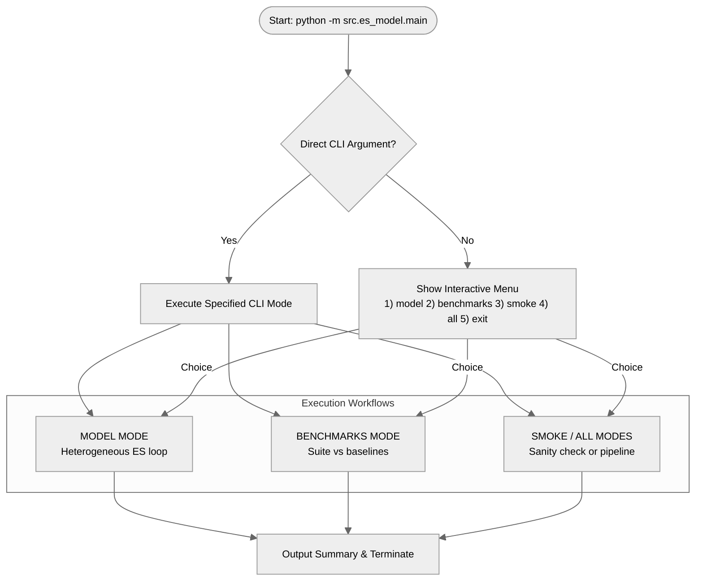
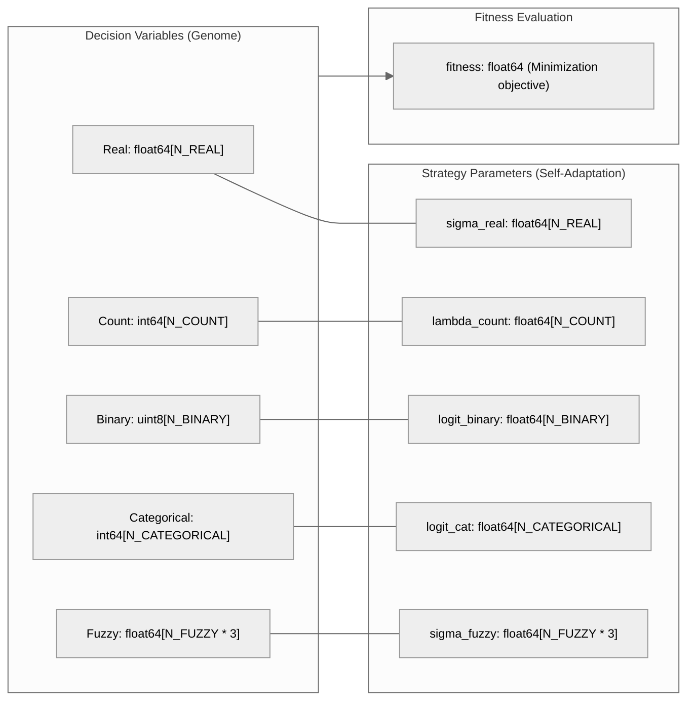
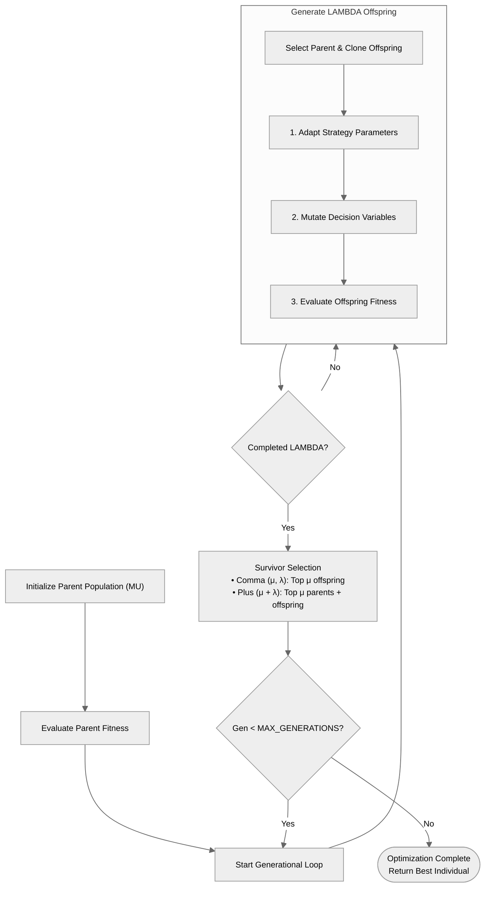
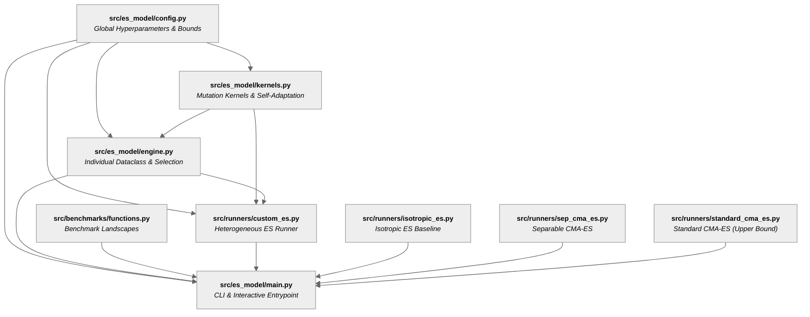

# Heterogeneous Evolution Strategies for Mixed-Variable Optimization

A prototype and experimental framework for **Heterogeneous Evolution Strategies (ES)** supporting mixed-variable optimization under $(\mu, \lambda)$ and $(\mu + \lambda)$ selection schemes with log-normal/logit-normal self-adaptation. Includes benchmark suites and comparison runners against baseline optimizers (*Isotropic ES*, *sep-CMA-ES*, and *Standard CMA-ES*).

---

## Architecture & Technical Overview

### 1. Mixed-Variable Genome & Mutation Kernels

The system co-evolves 5 decision variable types alongside their respective strategy parameters within a unified `Individual` genome:

| Variable Type | Domain | Strategy Parameter | Mutation Operator | Mathematical Kernel / Dynamics |
| :--- | :--- | :--- | :--- | :--- |
| **Real ($\mathbb{R}$)** | $\mathbb{R}^{N_{\text{real}}}$ | $\sigma_{\text{real}} \in \mathbb{R}_{>0}^{N_{\text{real}}}$ | Gaussian | $x' = \text{clip}(x + \sigma \cdot \mathcal{N}(0,1), [L, U])$ |
| **Count ($\mathbb{Z}$)** | $\mathbb{Z}_{\ge 0}^{N_{\text{count}}}$ | $\lambda_{\text{count}} \in \mathbb{R}_{>0}^{N_{\text{count}}}$ | Skellam | $x' = \text{clip}(x + \text{Poisson}(\lambda) - \text{Poisson}(\lambda), [L, U])$ |
| **Binary ($\mathbb{B}$)** | $\mathbb{B}^{N_{\text{binary}}}$ | $\text{logit}_{\text{binary}} \in \mathbb{R}^{N_{\text{binary}}}$ | Bit-Flip | XOR guided by Bernoulli($p$), where $p = \frac{1}{1 + e^{-\text{logit}}}$ |
| **Categorical ($\mathbb{C}$)** | $\mathbb{C}^{N_{\text{cat}}}$ | $\text{logit}_{\text{cat}} \in \mathbb{R}^{N_{\text{cat}}}$ | Uniform Resample | Resample uniformly from $\mathbb{C} \setminus \{x_i\}$ with probability $p$ |
| **Fuzzy ($\mathbb{F}$)** | $\mathbb{F}^{3 \cdot N_{\text{fuzzy}}}$ | $\sigma_{\text{fuzzy}} \in \mathbb{R}_{>0}^{3 \cdot N_{\text{fuzzy}}}$ | Gaussian + Constraints | Perturb triplets $(a, b, c)$, specular reflect on $[0, 1]$, enforce monotonic interlocking $a \le b \le c$ ($\epsilon=10^{-4}$) |

### 2. Self-Adaptation Rules

- **Global & Local Learning Rates:**
  $$\tau' = \frac{1}{\sqrt{2 \cdot N_{\text{total}}}}, \quad \tau = \frac{1}{\sqrt{2 \cdot \sqrt{N_{\text{total}}}}}$$

- **Log-Normal Adaptation** (for step-sizes $\sigma_{\text{real}}, \lambda_{\text{count}}, \sigma_{\text{fuzzy}}$):
  $$\sigma_i' = \max\left(\sigma_{\text{floor}}, \, \sigma_i \cdot \exp\left(\tau' \cdot \mathcal{N}(0,1) + \tau \cdot \mathcal{N}_i(0,1)\right)\right), \quad \sigma_{\text{floor}} = 10^{-6}$$

- **Logit-Normal Adaptation** (for mutation probabilities $p_{\text{binary}}, p_{\text{cat}}$):
  $$\text{logit}_i' = \text{logit}_i + \tau' \cdot \mathcal{N}(0,1) + \tau \cdot \mathcal{N}_i(0,1), \quad p = \frac{1}{1 + e^{-\text{logit}'}}$$

---

## Diagrams & Control Flow

### 1. Global Execution Flow (`main.py`)



### 2. Individual Genome Structure



### 3. Evolutionary Generational Loop



---

## Project Structure & Module Dependency Matrix

```text
TFG/
├── README.md                              # Main documentation (this file)
├── requirements.txt                       # Python dependencies
├── docs/                                  # Technical documentation docs
├── openspec/                              # OpenSpec design specifications
├── src/                                   # Source code
│   ├── es_model/                          #   Heterogeneous ES Engine
│   │   ├── config.py                      #     Global hyper-parameters, bounds & seeds
│   │   ├── kernels.py                     #     Vectorized pure mutation operators & self-adaptation
│   │   ├── engine.py                      #     Individual dataclass, cloning & selection
│   │   └── main.py                        #     CLI entrypoint & interactive menu
│   ├── benchmarks/                        #   Objective Benchmark Functions
│   │   └── functions.py                   #     Sphere, Rastrigin, Rosenbrock, Ackley
│   └── runners/                           #   Experimental Benchmark Runners
│       ├── custom_es.py                   #     Heterogeneous ES wrapper for continuous benchmarks
│       ├── isotropic_es.py                #     Isotropic ES baseline (single scalar step-size)
│       ├── one_plus_one_es.py             #     (1+1)-ES reference runner
│       ├── sep_cma_es.py                  #     Separable CMA-ES wrapper
│       └── standard_cma_es.py             #     Standard CMA-ES wrapper (Upper Bound)
└── experiments/                           # Analytical notebooks
    └── notebooks/
        └── experiment_1.ipynb             # Equal-budget benchmark comparison notebook
```

### Module Dependency Graph



### Module Dependency Matrix

| Module | Responsibility | Key Symbols / Classes | Internal Dependencies | Imported By |
| :--- | :--- | :--- | :--- | :--- |
| [`src/es_model/config.py`](file:///c:/Users/bejmo/Documents/documents/GitHub/TFG/src/es_model/config.py) | Configuration constants & bounds | `MU`, `LAMBDA`, `N_REAL`, `N_COUNT`, `REAL_BOUNDS`, `SIGMA_FLOOR` | *None* | `kernels`, `engine`, `main`, `custom_es` |
| [`src/es_model/kernels.py`](file:///c:/Users/bejmo/Documents/documents/GitHub/TFG/src/es_model/kernels.py) | Vectorized pure mutation kernels | `adapt_scales()`, `adapt_logits()`, `mutate_real()`, `mutate_count()`, `mutate_fuzzy()` | `config` | `engine`, `custom_es` |
| [`src/es_model/engine.py`](file:///c:/Users/bejmo/Documents/documents/GitHub/TFG/src/es_model/engine.py) | Individual dataclass & lifecycle | `Individual`, `create_random_individual()`, `mutate_individual()`, `select_survivors()` | `config`, `kernels` | `main`, `custom_es` |
| [`src/es_model/main.py`](file:///c:/Users/bejmo/Documents/documents/GitHub/TFG/src/es_model/main.py) | CLI entrypoint & interactive menu | `run()`, `run_model()`, `run_benchmarks()`, `main()` | `config`, `engine`, `functions`, runners | *Main entrypoint* |
| [`src/benchmarks/functions.py`](file:///c:/Users/bejmo/Documents/documents/GitHub/TFG/src/benchmarks/functions.py) | Test objective landscapes | `sphere()`, `rastrigin()`, `rosenbrock()`, `ackley()` | *None* | `main`, `experiment_1` |
| [`src/runners/custom_es.py`](file:///c:/Users/bejmo/Documents/documents/GitHub/TFG/src/runners/custom_es.py) | Adapter for Heterogeneous ES | `run()` | `config`, `kernels`, `engine` | `main`, `experiment_1` |
| [`src/runners/isotropic_es.py`](file:///c:/Users/bejmo/Documents/documents/GitHub/TFG/src/runners/isotropic_es.py) | Baseline Isotropic ES | `run()`, `IsotropicIndividual` | *None* | `main`, `experiment_1` |
| [`src/runners/sep_cma_es.py`](file:///c:/Users/bejmo/Documents/documents/GitHub/TFG/src/runners/sep_cma_es.py) | Baseline Separable CMA-ES | `run()` (via `cma`) | *None* | `main`, `experiment_1` |
| [`src/runners/standard_cma_es.py`](file:///c:/Users/bejmo/Documents/documents/GitHub/TFG/src/runners/standard_cma_es.py) | Upper-bound Full CMA-ES | `run()` (via `cma`) | *None* | `main`, `experiment_1` |

---

## Quick Setup

### Prerequisites
- **Python 3.12+** (tested on CPython 3.14)
- Operating System: Windows / Linux / macOS

```bash
# 1. Create virtual environment
python -m venv .venv

# 2. Activate virtual environment
# Windows (PowerShell)
.venv\Scripts\activate
# Linux / macOS
source .venv/bin/activate

# 3. Install dependencies
pip install -r requirements.txt
```

---

## Running the Project

Run all execution commands from the **project root** directory.

### Interactive Terminal Menu (Recommended)

```bash
python -m src.es_model.main
```

Available menu options:
- `model`: Runs the Heterogeneous ES optimization loop on the default model configuration.
- `benchmarks`: Runs benchmark evaluations across test functions against reference optimizers.
- `smoke`: Fast sanity check run with minimal evaluation budget.
- `all`: Sequentially executes `model` followed by `benchmarks`.
- `exit`: Exits the application.

### Direct CLI Commands

```bash
# Model run with custom generations
python -m src.es_model.main model --generations 200 --log-interval 20

# Benchmark suite on dim 20 with budget of 50,000 evaluations across 5 seeds
python -m src.es_model.main benchmarks --dim 20 --max-evals 50000 --seeds 5

# Quick smoke validation
python -m src.es_model.main smoke --dim 5 --max-evals 200 --seeds 2
```

### Notebook Experiments

Open `experiments/notebooks/experiment_1.ipynb` in Jupyter or VS Code to run equal-budget benchmark comparisons and plot convergence curves.

---

## Dependencies

| Package | Usage |
|:---|:---|
| `numpy` | Vectorized array calculations and typed operations |
| `scipy` | Mathematical functions & probability distributions |
| `cma` | Baseline CMA-ES and separable CMA-ES implementations |
| `matplotlib` | Plotting convergence graphs in notebooks |
| `pyswarms` | Particle Swarm Optimization (legacy reference) |

---

## License

Academic project - Heterogeneous Evolution Strategies for Mixed-Variable Optimization.
