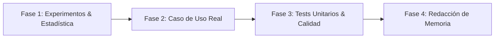

# Roadmap y Plan de Trabajo - TFG Heterogeneous Evolution Strategies

Este documento detalla la hoja de ruta y los siguientes pasos estratégicos para la extensión, validación y redacción final de la Memoria del **Trabajo de Fin de Grado (TFG)**: *Heterogeneous Evolution Strategies for Mixed-Variable Optimization*.

---

## 📌 1. Resumen del Estado Actual

El proyecto cuenta actualmente con una arquitectura técnica y experimental plenamente funcional:

- **Motor Heterogéneo $(\mu, \lambda)$-ES** ([`engine.py`](file:///c:/Users/bejmo/Documents/documents/GitHub/TFG/src/es_model/engine.py)): Soporte completo para 6 tipos de variables (Reales $\mathbb{R}$, Enteras/Count $\mathbb{Z}$, Binarias $\mathbb{B}$, Categóricas $\mathbb{C}$, Difusas/Fuzzy $\mathbb{F}$ y Circulares $\mathbb{O}$).
- **Kernels de Auto-Adaptación** ([`kernels.py`](file:///c:/Users/bejmo/Documents/documents/GitHub/TFG/src/es_model/kernels.py)): Log-normal para pasajes de escala ($\sigma, \lambda_{\text{count}}$) y Logit-normal para variables probabilísticas.
- **Algoritmos de Referencia** ([`src/runners/`](file:///c:/Users/bejmo/Documents/documents/GitHub/TFG/src/runners)): Adapters para *Isotropic ES*, *sep-CMA-ES* y *Standard CMA-ES*.
- **Suite de Benchmarks Mixtos Sintéticos** ([`heterogeneous_functions.py`](file:///c:/Users/bejmo/Documents/documents/GitHub/TFG/src/benchmarks/heterogeneous_functions.py)): Funciones *Heterogeneous_Sphere*, *Heterogeneous_Rastrigin* y *Heterogeneous_Coupled*.
- **Cuadernos de Experimentación** ([`experiments/`](file:///c:/Users/bejmo/Documents/documents/GitHub/TFG/experiments)):
  - [`experiment_1.ipynb`](file:///c:/Users/bejmo/Documents/documents/GitHub/TFG/experiments/experiment_1.ipynb): Comparativa de rendimiento frente a baselines.
  - [`experiment_2.ipynb`](file:///c:/Users/bejmo/Documents/documents/GitHub/TFG/experiments/experiment_2.ipynb): Análisis de dinámicas internas y evolución de parámetros de estrategia ($\sigma$ y logits).

---

## 🎯 2. Objetivos y Fases Pendientes

### 🔬 Fase 1: Experimentación Avanzada y Validación Estadística
*Objetivo: Aportar rigor científico a las conclusiones de la memoria mediante análisis paramétricos y pruebas de hipótesis.*

1. **Estudios de Ablación (Ablation Studies)**:
   - Presión de selección: Evaluar $(\mu, \lambda) \in \{(5, 35), (15, 100), (30, 200)\}$ y la variante Plus $(\mu + \lambda)$ frente a Comma $(\mu, \lambda)$.
   - Operadores de Recombinación: Analizar el impacto de la recombinación discreta doble en genotipo vs. recombinación intermedia global en parámetros de estrategia vs. sin recombinación.
2. **Análisis de Escalabilidad Dimensional**:
   - Evaluar el comportamiento a medida que escala la dimensión total $N \in \{12, 30, 60, 120\}$.
   - Variar la cardinalidad de variables categóricas ($C_k \in \{3, 5, 10\}$) y circulares ($k \in \{4, 7, 12\}$).
3. **Validación Estadística No Paramétrica**:
   - Ejecución de experimentos con 30 semillas independientes por configuración.
   - Aplicación del **Test de Wilcoxon Signed-Rank** (para comparaciones binarias contra CMA-ES e Isotropic ES).
   - Aplicación del **Test de Friedman con post-hoc Holm/Dunn** para el ranking global de algoritmos.
   - Generación automática de tablas de p-valores para la memoria.

---

### 🏭 Fase 2: Caso de Uso Práctico / Problema Real de Ingeniería
*Objetivo: Demostrar la aplicabilidad del algoritmo heterogéneo en un entorno práctico del mundo real.*

1. **Diseño del Problema Mixto**:
   - **Opción A (Recomendada - ML/DL)**: Optimización conjunta de arquitectura e hiperparámetros de red neuronal (*Joint Neural Architecture & Hyperparameter Search*):
     - *Reales*: Learning rate, weight decay, momentum.
     - *Enteras*: Número de capas, neuronas/canales por capa.
     - *Binarias*: Activación/desactivación de conexiones residuales (*skip connections*), dropout enable/disable.
     - *Categóricas*: Tipo de función de activación (ReLU, GELU, Swish), optimizador (AdamW, SGD, RMSprop).
     - *Fuzzy*: Intervalos de tolerancia para early stopping o data augmentation.
     - *Circulares*: Programación de fases de aprendizaje (*cyclical learning rate phase/angle*).
   - **Opción B (Ingeniería Mecánica/Industrial)**: Diseño óptimo de recipiente a presión o tren de engranajes con restricciones de materiales categóricos y tolerancias difusas.
2. **Evaluación de Rendimiento**:
   - Comparación del ES Heterogéneo frente a búsqueda aleatoria (*Random Search*) y Optuna/TPE en dicho problema real.

---

### 🧪 Fase 3: Batería de Tests Unitarios y Calidad de Código
*Objetivo: Garantizar la corrección del software y facilitar la reproducibilidad.*

1. **Creación del Suite de Pruebas (`tests/`) con `pytest`**:
   - `test_kernels.py`: Verificar propiedades matemáticas invariantes:
     - Orden monotónico estricto $a \le b \le c$ y acotación $[0, 1]$ tras mutación Fuzzy.
     - Suma unitaria de probabilidades Softmax ($\sum p_i = 1$) en Categóricas.
     - Acotación Skellam y prevención de desbordamientos en Count/Integers.
     - Clipping seguro de logits binarios en $[-700, 700]$.
     - Transitividad modular en variables Circulares.
   - `test_engine.py`: Pruebas de integración del bucle generacional, selección por orden de fitness y elisión de individuos inválidos.
   - `test_config.py`: Validación de la inmutabilidad de la configuración y cálculo correcto de tasas de aprendizaje $\tau, \tau'$.
2. **CI/CD & Reproducibilidad**:
   - Automatización de ejecución de tests en GitHub Actions (opcional).

---

### 📝 Fase 4: Estructura y Redacción de la Memoria del TFG
*Objetivo: Redactar una memoria clara, rigurosa y visualmente atractiva.*

#### Estructura Propuesta por Capítulos:

1. **Capítulo 1: Introducción y Objetivos**
   - Contextualización de los problemas de optimización en dominios mixtos.
   - Objetivos general y específicos del TFG.
   - Estructura del documento.
2. **Capítulo 2: Estado del Arte**
   - Estrategias de Evolución $(\mu, \lambda)$-ES y auto-adaptación log-normal.
   - Algoritmos de covarianza (CMA-ES, sep-CMA-ES).
   - Estado del arte en optimización heterogénea y tratamiento de variables discretas/difusas.
3. **Capítulo 3: Diseño y Arquitectura del Motor Heterogéneo**
   - Representación del genotipo heterogéneo.
   - Operadores de mutación y dinámicas de auto-adaptación log-normal/logit-normal por tipo de variable.
   - Recombinación (Dual Discrete & Global Intermediate) y mecanismos de selección.
4. **Capítulo 4: Experimentación y Análisis de Resultados**
   - Descripción de las funciones benchmark heterogéneas sintéticas.
   - Resultados comparativos frente a baselines (Gráficos de convergencia y tablas estadísticas).
   - Dinámicas de adaptación interna ($\sigma$ y logits).
   - Estudios de ablación y escalabilidad dimensional.
   - Resultados en el Caso de Uso Práctico.
5. **Capítulo 5: Conclusiones y Trabajo Futuro**
   - Cumplimiento de objetivos y contribuciones principales.
   - Limitaciones identificadas.
   - Líneas de investigación futuras (ej. matriz de covarianza por bloques heterogéneos).

---

## 📅 3. Cronograma Sugerido de Ejecución

| Semana / Hito | Tareas Principales | Entregables / Archivos |
| :--- | :--- | :--- |
| **Hito 1** | Implementación de `tests/` con `pytest` | `tests/test_kernels.py`, `tests/test_engine.py` |
| **Hito 2** | Experimentos de Ablación y Escalabilidad | `experiments/experiment_3_ablation.ipynb` |
| **Hito 3** | Tests Estadísticos (Wilcoxon/Friedman) | Scripts de análisis estadístico y tablas LaTeX |
| **Hito 4** | Implementación y Evaluación del Caso de Uso Real | `src/benchmarks/real_world_case.py` |
| **Hito 5** | Redacción de Capítulos 1, 2 y 3 de la Memoria | Borrador de la memoria en LaTeX / Markdown |
| **Hito 6** | Redacción de Capítulos 4 y 5 y Revisión Final | Versión final de la memoria del TFG |

---

> Documento generado como guía oficial de desarrollo para el TFG.
