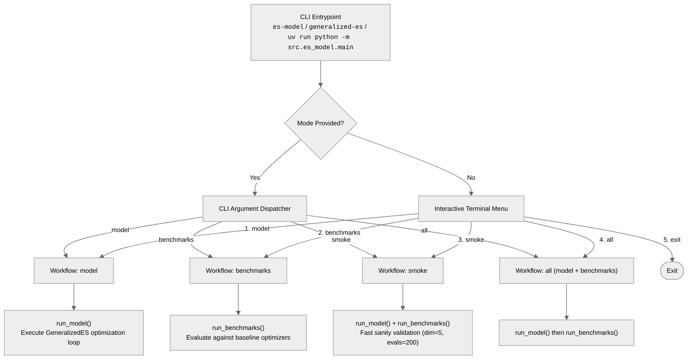
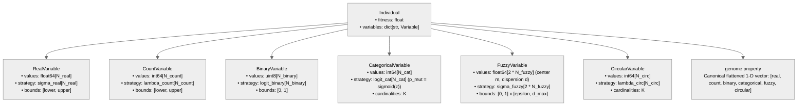
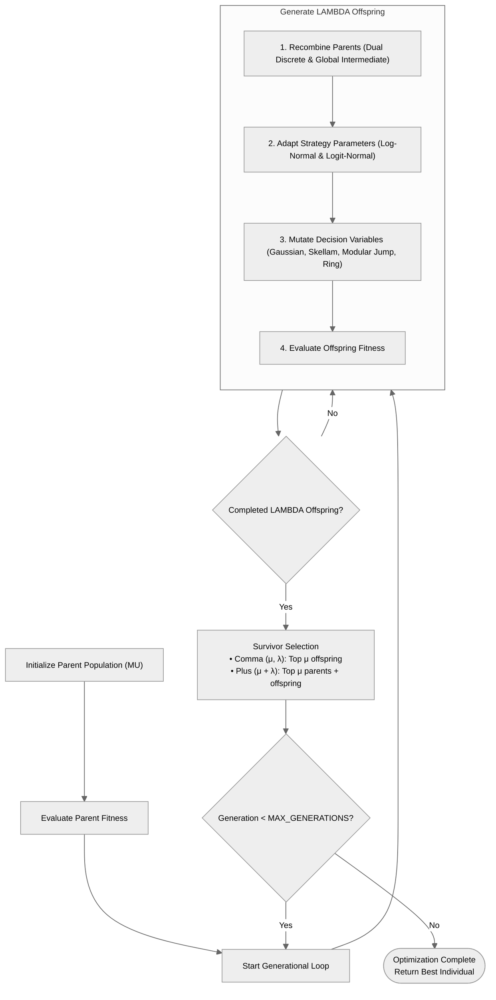
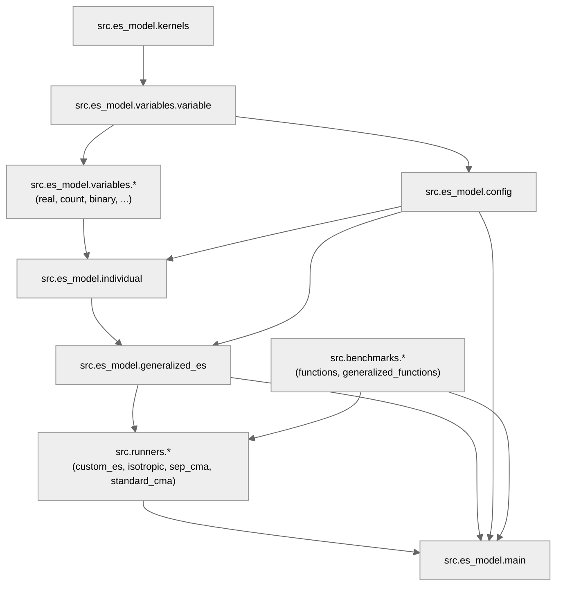

# Architecture & Technical Documentation

This document provides in-depth technical documentation for the **Generalized Evolution Strategies (ES)** framework, covering module design, execution control flows, genome data structures, and the complete dependency matrix.

---

## 1. System Execution & Control Flow

### CLI Dispatcher & Workflows

The framework provides an interactive terminal menu and direct command-line arguments orchestrated by `src.es_model.main`:



---

## 2. Genome & Candidate Representation

Each candidate solution in the population is encapsulated by an `Individual` instance containing a polymorphic dictionary of variables co-evolving their internal strategy parameters:



---

## 3. Algorithmic Lifecycle Loop

The generational lifecycle adheres to canonical $(\mu, \lambda)$-ES and $(\mu + \lambda)$-ES dynamics:



---

## 4. Project Structure

```text
TFG/
├── README.md                                               # Main project overview and quick start
├── pyproject.toml                                          # Project metadata, dependencies & CLI scripts (PEP 621)
├── uv.lock                                                 # Deterministic cross-platform lockfile
├── .python-version                                         # Pinned Python version (3.12)
├── docs/                                                   # In-depth architectural & technical documentation
│   └── architecture.md                                     # System design, module matrix, and control flow
├── src/                                                    # Core source code
│   ├── es_model/                                           #   Generalized ES Engine
│   │   ├── config.py                                       #     Problem settings, bounds, dimensions & learning rates
│   │   ├── kernels.py                                      #     Pure math functions for activation & self-adaptation
│   │   ├── individual.py                                   #     Candidate solution representation & genetic operators
│   │   ├── generalized_es.py                               #     GeneralizedES optimizer class & survivor selection
│   │   ├── main.py                                         #     CLI entrypoint, interactive menu & execution workflows
│   │   └── variables/                                      #     Modular variable representations & mutation operators
│   │       ├── variable.py                                 #       Variable ABC & resolve_bounds utility
│   │       ├── real.py                                     #       RealVariable (Gaussian mutation with reflection)
│   │       ├── count.py                                    #       CountVariable (Skellam mutation with clipping)
│   │       ├── binary.py                                   #       BinaryVariable (Bit-flip mutation via sigmoid)
│   │       ├── categorical.py                              #       CategoricalVariable (Modular jump with phenotypic inertia)
│   │       ├── fuzzy.py                                    #       FuzzyVariable (Center-dispersion parameterization with reflection)
│   │       └── circular.py                                 #       CircularVariable (Modular Skellam ring mutation)
│   ├── benchmarks/                                         #   Objective Benchmark Landscapes
│   │   ├── functions.py                                    #     Standard continuous landscapes (Sphere, Rastrigin, Ackley)
│   │   └── generalized_functions.py                        #     Synthetic mixed-variable landscapes testing all 6 types
│   └── runners/                                            #   Experimental Benchmark Runners
│       ├── custom_es.py                                    #     Generalized ES runner adapter
│       ├── isotropic_es.py                                 #     Isotropic ES baseline (single scalar step-size)
│       ├── sep_cma_es.py                                   #     Separable CMA-ES baseline wrapper
│       └── standard_cma_es.py                              #     Standard CMA-ES upper-bound runner
├── tests/                                                  # Unit & integration test suites
│   ├── test_variables.py                                   #     Variable representations & mutation tests
│   ├── test_individual_and_es.py                           #     Candidate individual & ES optimization cycle tests
│   ├── test_benchmarks.py                                  #     Continuous & generalized benchmark landscape tests
│   └── test_catcmawm_baseline.py                           #     CatCMAwM baseline adapter & domain invariant tests
└── experiments/                                            # Experimental suites & analysis
    ├── experiment_1/                                       #     Continuous benchmarks vs. isotropic/sep/standard CMA-ES
    │   ├── experiment_1.ipynb                              #       Analysis notebook & figures
    │   └── runners/run_experiment_1.py                     #       Execution & statistical testing runner
    ├── experiment_2/                                       #     Dynamic Target Shift (DTS) transversal dynamic tracking
    │   ├── experiment_2.ipynb                              #       Analysis notebook & transversal dynamic tracking
    │   └── runners/                                        #       Execution and plotting scripts
    ├── experiment_3/                                       #     Heterogeneous mixed-variable benchmarks (4-way comparison)
    │   ├── experiment_3.ipynb                              #       Interactive analysis notebook
    │   ├── runners/                                        #       Execution scripts & statistical testing
    │   │   ├── run_experiment_3.py                         #         Main runner & paired Wilcoxon hypothesis testing
    │   │   ├── run_exp3_baselines.py                       #         External baselines runner (RS, CMA-ES, CatCMAwM)
    │   │   ├── runners.py                                  #         Generalized ES benchmark suite runners
    │   │   └── plotting.py                                 #         Convergence curves (Median/IQR) & parameter dynamics
    │   └── data/                                           #       Raw traces (.npz) & baseline results (.json)
    └── extra/                                              #     Supplementary validation studies (Appendix E)
        ├── categorical/                                    #       Categorical operator validation & binary equivalence
        └── circular_and_geometric_mean/                    #       Modular circular & geometric mean validation
```

---

## 5. Module Dependency Graph



---

## 6. Module Dependency Matrix

| Module | Primary Responsibility | Key Symbols / Classes | Internal Dependencies | Imported By |
| :--- | :--- | :--- | :--- | :--- |
| `src.es_model.config` | Configuration dataclass, hyper-parameters, bounds & learning rates | `ESConfig`, `DEFAULT_CONFIG` | `variables.variable` | `individual`, `generalized_es`, `main`, `runners`, `tests` |
| `src.es_model.kernels` | Stateless numerical primitives, log-normal/logit adaptation, activation | `apply_lognormal_selfadaptation`, `adapt_logits`, `sigmoid`, `softmax` | None | `variables.variable`, all variable modules |
| `src.es_model.variables.variable` | Abstract base class for variable types and universal bounds resolver | `Variable`, `resolve_bounds` | `kernels` | `config`, all concrete variable modules |
| `src.es_model.variables.*` | Concrete variable implementations with type-specific mutations | `RealVariable`, `CountVariable`, `BinaryVariable`, `CategoricalVariable`, `FuzzyVariable`, `CircularVariable` | `variable.Variable`, `kernels` | `individual`, `tests` |
| `src.es_model.individual` | Candidate solution representation, discrete recombination & genome extraction | `Individual`, `UnpackedGenome`, `unpack_genome` | `config`, `variables` | `generalized_es`, `main`, `benchmarks`, `tests` |
| `src.es_model.generalized_es` | Stateful optimization engine and $(\mu, \lambda) / (\mu + \lambda)$ survivor selection | `GeneralizedES`, `select_survivors` | `config`, `individual` | `main`, `runners.custom_es`, `tests` |
| `src.benchmarks.functions` | Standard continuous optimization landscapes | `BENCHMARKS` (`Sphere`, `Rastrigin`, `Rosenbrock`, `Ackley`) | None | `main`, `runners`, `tests` |
| `src.benchmarks.generalized_functions` | Synthetic mixed-variable test landscapes across all 6 domain types | `sphere_generalized`, `rastrigin_generalized`, `coupled_generalized` | `config`, `individual` | `experiments`, `tests` |
| `src.runners.*` | Optimizer execution adapters and baseline wrappers | `custom_es.run`, `isotropic_es.run`, `sep_cma_es.run`, `standard_cma_es.run` | `generalized_es`, `config` | `main` |
| `src.es_model.main` | Unified CLI parser, interactive menu & workflow orchestrator | `main`, `run_model`, `run_benchmarks` | `config`, `generalized_es`, `benchmarks`, `runners` | CLI entrypoints (`es-model`, `generalized-es`) |
| `experiments.experiment_3.runners.run_exp3_baselines` | External heterogeneous baselines runner (RS, CMA-ES with Rounding, CatCMAwM) | `RandomSearchRunner`, `CMARoundingRunner`, `CatCMAwMRunner`, `run_all_baselines` | `benchmarks.generalized_functions`, `config` | `run_experiment_3`, `tests.test_catcmawm_baseline` |
| `experiments.experiment_3.runners.run_experiment_3` | Heterogeneous benchmark orchestration, plotting & Wilcoxon hypothesis testing | `compute_wilcoxon_table_exp3`, `holm_bonferroni`, `main` | `benchmarks.generalized_functions`, `config`, `run_exp3_baselines`, `plotting` | `experiments/experiment_3.ipynb`, CLI |
